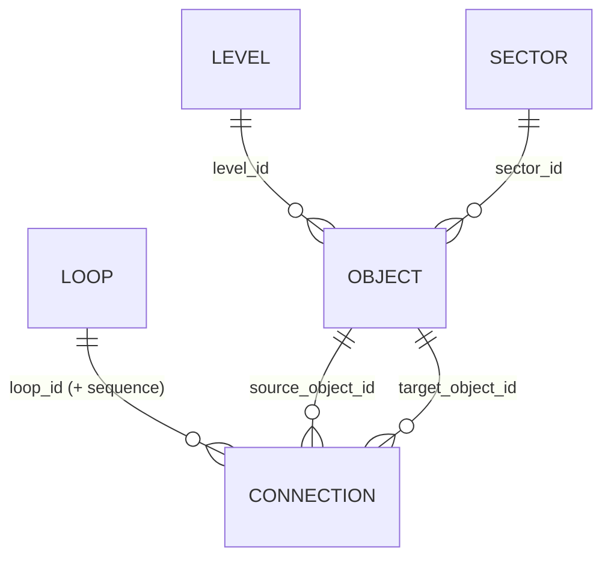
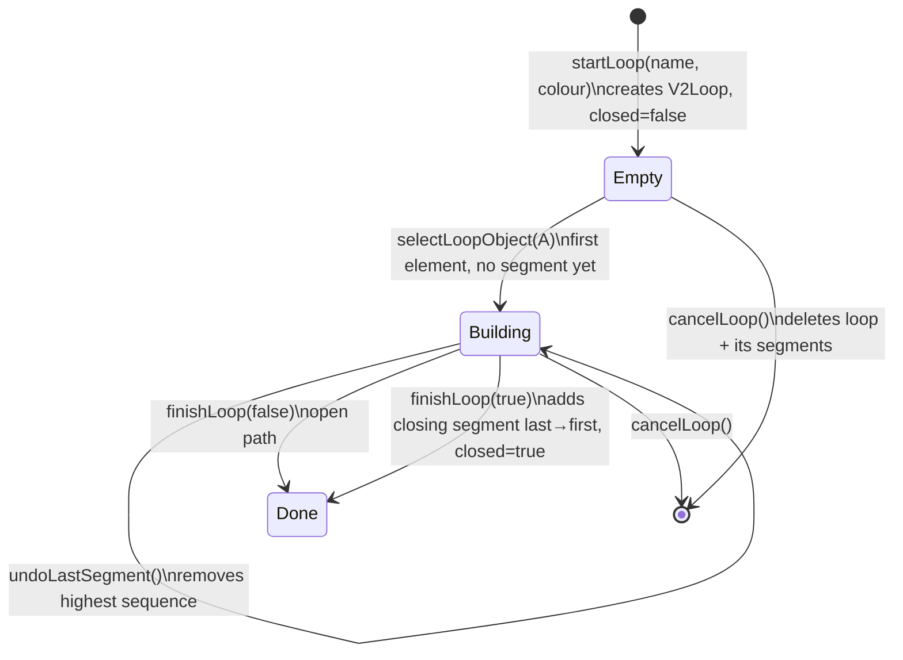

# Data Model — Objects, Connections and Loops

This document covers how the Manufacturing Data Pyramid models its data today, focusing on **connections and loops**, and then weighs the pros and cons of moving to an explicit **graph model**.

Scope: the Walkthrough mode model (`V2Case`, `src/v2/`), which is what gets saved to the server. The older Explorer model is summarised in §6.

---

## 1. The current model at a glance

Everything lives in one JSON document, the **case**:

```ts
V2Case {
  id, name
  levels:  V2Level[]            // { id, index, name }        vertical tiers
  sectors: V2Sector[]           // { id, index, name }        angular slices
  grid:    { width, height }    // canonical placement grid, shared by all levels
  overlays: {
    data:      V2Object[]       // the elements users place
    models:    V2Object[]       // reserved, currently always empty
    agents:    V2Object[]       // reserved, currently always empty
    decisions: V2Object[]       // reserved, currently always empty
    loops:        V2Loop[]       // named paths
    connectivity: V2Connection[] // directed segments, each belonging to one loop
  }
}
```

Source: `artifacts/manufacturing-data-pyramid/src/v2/types.ts`.



### 1.1 Objects (nodes)

```ts
V2Object {
  id, overlay: 'data' | 'models' | 'agents' | 'decisions'
  level_id, sector_id, grid_x, grid_y        // placement
  name, description, availability, source, protocol, format,
  data_type, frequency, sensing_settings, preprocessing, intended_use  // metadata (all strings)
}
```

- **Placement is three coordinates**: a level, a grid cell `(grid_x, grid_y)`, and a sector.
- `sector_id` is **derived** from the grid cell: the cell's angle around the grid centre picks the sector (`getSectorIdForGridCell` in `src/v2/geometry.ts`). It is stored anyway, so it can drift out of sync if sectors change.
- One object per cell per level (enforced by the UI, not by the server).

### 1.2 Loops

```ts
V2Loop { id, name, description, color, closed }
```

A loop is a **named, coloured, ordered path**. It holds no list of its segments; the segments point to it.

### 1.3 Connections (segments)

```ts
V2Connection {
  id
  loop_id                      // which loop this segment belongs to
  sequence                     // 0, 1, 2 … position within the loop
  source_object_id
  target_object_id
  direction: 'source_to_target' // the only value
  label?, description?
}
```

**Every connection belongs to exactly one loop.** There is no such thing as a loose connection that isn't in a loop.

---

## 2. How loops are built

Loop construction is a small state machine in `src/v2/store.ts`. The in-progress state (`loopBuilder`) is **not** persisted.



Rules enforced while clicking (`selectLoopObject`):

| Rejection | Rule |
|---|---|
| `self` | Can't connect an element to itself. |
| `repeated` | An element **already used anywhere in this loop** can't be picked again (only the closing segment may return to the first element). |
| `missing` | The element must exist in `overlays.data`. Only `data` objects can be in loops. |
| `inactive` | No loop is being built. |

**What that means:** every loop is a **simple path**, or a **simple cycle** when closed. It can't visit a node twice, branch, or merge. An element **can** belong to several different loops.

### Worked example

Loop "Predictive Maintenance" through Vibration (L1) → Machine State (L2) → Condition Assessment (L3) → Reliability KPI (L4) → Asset Decision (L5), then closed:

| id | loop_id | sequence | source | target |
|---|---|---|---|---|
| c1 | pm | 0 | Vibration | Machine State |
| c2 | pm | 1 | Machine State | Condition Assessment |
| c3 | pm | 2 | Condition Assessment | Reliability KPI |
| c4 | pm | 3 | Reliability KPI | Asset Decision |
| c5 | pm | 4 | Asset Decision | Vibration *(closing segment)* |

---

## 3. Editing and deleting: what happens to the path

| Action | Effect | Note |
|---|---|---|
| `updateConnection` | Changes label/description only. | Endpoints can't be edited. |
| `deleteConnection` | Removes one segment. | **Sequences are not renumbered**, so the path gets a gap (c1, c2, c4 …): segment *n*'s target no longer equals segment *n+1*'s source. |
| `deleteLoop` | Removes the loop and all its segments. | Objects stay. |
| `removeDataObject` | Removes the object, every segment touching it, and any loop left with no segments. | A loop through the deleted object is **split into disconnected pieces** but keeps `closed: true`. |
| `clearDataLevel` | Same cascade, for a whole level. | |

So the model **stores** a path as "segments + sequence numbers" but nothing guarantees the segments still **form** a path. Today's 3D/2D rendering simply draws each segment.

### Validation (server, `api-server/src/routes/v2Save.ts`)

Checked on save: each segment's loop exists, its endpoints exist, and no two segments in the same loop share a sequence number.

**Not checked**: contiguity (segment *n*.target = *n+1*.source), sequences starting at 0 with no gaps, `closed` matching the actual shape, no repeated nodes, and sector consistent with grid cell.

### Migration

The browser draft is persisted with a Zustand `version` (currently 9). `normalisePersistedLoops` upgrades older drafts where connections carried a loop **name**/colour instead of `loop_id`. It groups them by normalised name into first-class loops, with deterministic IDs (FNV hash → `loop_legacy_<hash>`) and sequence taken from the old order. Segment and endpoint IDs are preserved.

---

## 4. It's already a graph: just an implicit one

Read as a graph, the current model is:

- **Nodes** = `V2Object`s, with properties (metadata) and a position (level, sector, cell).
- **Edges** = `V2Connection`s: directed, with properties (label, description).
- **Loops** = a **colour/label on edges** plus an ordering. Formally, a set of edge-disjoint *walks*, each restricted to a simple path or cycle.
- Strictly it's a **directed multigraph**: if two loops both go A → B, that is two separate connection records.
- Levels and sectors are **node attributes** (or, alternatively, container nodes).

So "using graphs" is less a change of *what* is modelled and more a choice of three things:

1. **Make edges independent of loops**, i.e. a shared flow `A → B` that several loops traverse.
2. **Represent the graph explicitly** in the snapshot and in code, as nodes/edges plus graph algorithms.
3. **Store it in a graph database** (Neo4j, Apache AGE on Postgres, etc.).

These are separate decisions. Each is weighed below.

---

## 5. Options and trade-offs

### Option A: Keep the current model, add graph *views* in code

Keep the JSON shape. Build an in-memory adjacency structure when needed (plain `Map`s, or a library like `graphology`) for queries and validation.

**Pros**
- No migration, no change to saves, server validation, or the three version counters.
- Can fix the real weaknesses in §3 cheaply: renumber on delete, a `validateLoopPath()` (contiguity, `closed` honesty), and stronger server checks.
- Enough for queries like "which loops pass through this object?", "which objects have no connections?" and "loops crossing level X".

**Cons**
- Flows shared between loops are still duplicated records with no shared identity.
- Loops stay restricted to simple paths, so no branches, merges or sub-loops.

### Option B: Explicit graph model in the snapshot (nodes / edges / paths)

Separate **what connects** from **which loops use it**:

```ts
nodes: V2Object[]                         // unchanged
edges: { id, source, target, kind?, label?, description?, properties? }[]
loops: { id, name, colour, closed, edge_ids: string[] }   // ordered list of edge IDs
```

**Pros**
- **One fact, one record.** "Historian → MES" exists once, with its protocol/latency/owner, and any number of loops reuse it. Editing the edge updates every loop.
- Natural questions get easy answers: "which loops depend on this data flow?" and "what breaks if this source goes down?" (reachability / impact analysis).
- Edges can exist **outside** any loop. That covers plain data-lineage links, which the current model can't express.
- An ordered `edge_ids` array makes contiguity checkable in one pass, and makes reordering or inserting a step trivial (no sequence renumbering).
- Opens up graph algorithms: shortest path between levels, cycle detection (are there real feedback loops?), centrality (which data elements are hubs?), and connected components.
- Maps cleanly to standard formats (GraphML, JSON Graph Format, RDF) for export or interop.
- A natural home for the reserved `models` / `agents` / `decisions` overlays as **node types**, with typed edges like `feeds`, `trains`, `informs`, `triggers`.

**Cons**
- A breaking snapshot change. It needs a new `schemaVersion: 2`, a migration (collapse duplicate `(loop, source, target)` → shared edges), an updated server validator, and a Zustand version bump. Old saved versions must stay readable.
- **Per-loop edge annotations get tricky.** Today each segment has its own label ("Segment 3: vibration features"). If the edge is shared, a label meant for one loop shows up in all of them. You'd need both edge-level and loop-step-level properties (`loops[].steps: { edge_id, label }[]`).
- **Deleting gets harder.** Deleting an edge used by three loops breaks three loops, so the UI must warn or block, and choose between cascade, orphan or refuse.
- The loop builder and loop table UI must change: clicking A then B should *reuse* an existing A→B edge rather than create a new one.
- More moving parts for what is, today, mostly a visual storytelling tool.

### Option C: Graph database (Neo4j, Memgraph, Apache AGE, …)

Store objects as nodes and connections as relationships in a graph DB instead of one JSONB snapshot per version.

**Pros**
- Powerful cross-project queries in Cypher/Gremlin, e.g. "across all projects, which data sources feed executive decisions?" or "find every path from a level-1 sensor to a level-5 decision."
- Good if the pyramid becomes a **live enterprise data catalogue** that other systems query.
- Apache AGE runs inside Postgres, so you could keep one database.

**Cons**
- **Conflicts with the current versioning design.** Saves are immutable, append-only whole-case snapshots, which makes "reopen exactly as saved" trivial. Versioned graphs in a graph DB mean either copying the subgraph per version (heavy) or temporal properties on every node/edge (complex).
- A new infrastructure dependency: Docker, Replit hosting, backups and drivers. Drizzle has no graph support.
- Case sizes are small (tens to low hundreds of nodes per case). Any graph algorithm runs instantly in the browser, so a graph DB buys no performance.
- Two sources of truth unless the JSON snapshot is dropped entirely.

### Summary

| Concern | A: current + graph views | B: explicit graph JSON | C: graph DB |
|---|---|---|---|
| Migration cost | none | medium | high |
| Shared edges across loops | ✗ | ✓ | ✓ |
| Edges outside loops (lineage) | ✗ | ✓ | ✓ |
| Branches / merges in a loop | ✗ | possible (paths over a DAG) | ✓ |
| Per-loop step labels | ✓ (native) | needs step objects | needs relationship props |
| Path integrity checks | add a validator | easy (ordered edge list) | query-based |
| Graph algorithms | via in-memory lib | via in-memory lib | native |
| Cross-project queries | ✗ (per snapshot) | ✗ (per snapshot) | ✓ |
| Fits immutable snapshot versioning | ✓ | ✓ | ✗ (hard) |
| New infrastructure | none | none | yes |

---

## 6. Explorer mode model (for comparison)

The Explorer/forging case study (`src/data.ts`, `src/store.ts`) uses a simpler, non-persisted-to-server model:

```ts
DataObject   { id, name, type, source, level: 1..5, category, sector?, position?: [x,y,z] }
Relationship { id, sourceId, targetId, description }
ConnectionLoop { id, name, color, visible, relationships: Relationship[] }  // edges embedded in the loop
```

Positions are raw 3D coordinates and levels are fixed numbers 1–5. Loops **embed** their relationships rather than referencing them. This is the "legacy grouped" shape that the v2 migration converts from.

---

## 7. Recommendation

1. **Now (Option A):** fix the integrity gaps regardless of what comes next.
   - Renumber sequences after `deleteConnection`, and decide what `removeDataObject` does to a loop (split, bridge the gap, or mark `closed: false`).
   - Add a shared `validateLoopPath()` used by the client and by `validateSnapshot` on the server.
   - Optionally stop storing `sector_id` or validate it against the grid cell.
2. **When a real need appears (Option B):** move to explicit nodes / edges / loop-steps, inside the **same JSONB snapshot**, as `schemaVersion: 2`. The triggers are:
   - users want the same flow in several loops,
   - lineage links outside loops,
   - impact analysis,
   - typed model/agent/decision nodes.

   Keep per-loop step labels as `loops[].steps[]` so nothing visible is lost. Use an in-memory library such as `graphology` for algorithms.
3. **Only if the product becomes a cross-project catalogue (Option C):** add a graph DB as a **derived, queryable index** built from the latest snapshots, not as the source of truth. That keeps immutable versioning intact.

Open questions that decide between A and B:
- Should a loop ever revisit a node or branch? (Real feedback loops often pass through a shared hub such as a historian or MES.)
- Is a segment label a property of the **flow** (protocol, frequency) or of the **story the loop tells** ("step 3: detect drift")? If both, you need both levels.
- Will anyone query *across* projects, or is each pyramid self-contained?
