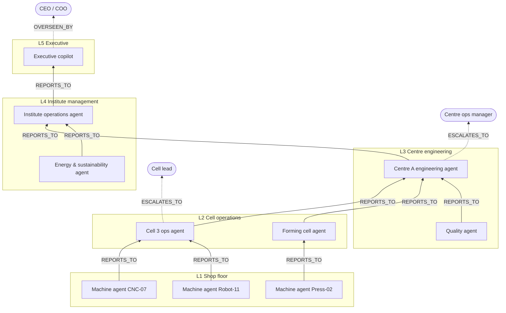

# Defining the Data for an Institution-Scale Pyramid

How to model a large manufacturing institution as one knowledge graph — for example a national institute such as NMIS (National Manufacturing Institute Scotland) — so that the pyramid, its many use cases and a hierarchy of agents all sit on the same data. It covers everything from shop-floor machines up through the organisation to the C-suite.

The RTM spoiler example was **one use case**. Here the pyramid is the **whole organisation**, and use cases live *inside* it.

> Names of centres, machines and figures below are **illustrative placeholders**. Replace them with the institute's real structure.

---

## 1. The core idea: three hierarchies on one graph

A large institution is described by three different hierarchies at once. Mixing them up is the most common modelling mistake.

| Hierarchy | Question it answers | Example path |
|---|---|---|
| **Pyramid levels** (abstraction / decision tier) | *How refined is this, and who acts on it?* | L1 signal → L2 operations → L3 engineering → L4 management → L5 executive |
| **Physical / asset containment** (ISA-95 style) | *Where is it?* | Institute → Site → Centre → Area → Cell → Machine → Sensor |
| **Organisation** (people, roles, agents) | *Who is responsible, and who reports to whom?* | Operator → Cell lead → Centre ops manager → Director → CEO |

They are **orthogonal**:
- A spindle-vibration stream is **L1**, located in **Centre A / Cell 3 / CNC-07**, owned by the **Centre A operations team**.
- An institute-wide energy KPI is **L4**, located at **Institute** scope, owned by the **COO**.

In the 3D pyramid, the **level** decides the height. **Sectors** can represent centres (or functions such as Quality, Maintenance, Energy, Research delivery). Containment and organisation are relationships you **drill into**, not extra axes.

```mermaid
flowchart TB
  subgraph Pyramid["Pyramid levels (height)"]
    L5[L5 Executive] --- L4[L4 Institute management] --- L3[L3 Centre engineering] --- L2[L2 Cell operations] --- L1[L1 Shop-floor signals]
  end
  subgraph Where["Containment (drill-down)"]
    I[Institute] --> S[Site] --> C[Centre] --> A[Area] --> Ce[Cell] --> M[Machine] --> Se[Sensor]
  end
  subgraph Who["Organisation (reporting)"]
    Op[Operator] --> CL[Cell lead] --> OM[Centre ops manager] --> D[Director] --> CEO
  end
```

---

## 2. "Tonnes of data": definition, stream, value

The graph must **never** hold raw machine data. Separate three tiers:

| Tier | What it is | Lives in | Volume | Example |
|---|---|---|---|---|
| **Data definition** | *What kind of data this is*: meaning, unit, typical rate. Defined once and reused | Graph (`:DataDefinition`) | Tens to hundreds | "Spindle vibration, mm/s RMS, 10 kHz" |
| **Data stream** | *A specific source of that data* on a specific asset, plus where to fetch it | Graph (`:DataStream`) holding a **pointer** (historian tag, topic, table, URI) | Thousands | "CNC-07 spindle vibration → historian tag `C1.CELL3.CNC07.SPV`" |
| **Values** | The actual measurements | Historian / time-series DB / data lake / MES | Billions of points | 10,000 readings per second |

Above that sit **derived** things, which *are* graph-worthy because they are few and meaningful:

| Derived | Lives in | Example |
|---|---|---|
| `:KPI` definition and its latest value | Graph (definition and latest/periodic values); history in time-series | OEE per cell per shift; energy per part |
| `:Event` (selected, significant) | Graph | "CNC-07 bearing alarm, 14:32" (not every alarm, only those that matter to a decision) |
| `:Finding`, `:Report`, `:Decision`, `:Action`, `:Outcome` | Graph | "Cell 3 OEE down 9% due to tool changes" |

**Rule of thumb:**
- **Graph** = meaning, lineage, ownership, decisions.
- **Time-series / historian** = numbers.
- **Documents / vector store** = text such as manuals, reports and procedures. Each document is linked to graph nodes.

Agents query the graph to find **what exists, what it means and where it lives**, then call a tool to fetch values from the right store.

### Rough sizing (illustrative)
200 machines × ~30 streams = ~6,000 stream nodes, plus ~50,000 relationships. That's small for Neo4j. The billions of values stay in the historian.

---

## 3. Node types (labels)

| Group | Labels | Key properties |
|---|---|---|
| **Place / assets** | `:Institute`, `:Site`, `:Centre`, `:Area`, `:Cell`, `:Machine`, `:Component`, `:Sensor` | id, name, type/model, criticality, ISA-95 path (`nmis/centre-a/area-2/cell-3/cnc-07`) |
| **Data** | `:DataDefinition`, `:DataStream`, `:Dataset`, `:KPI` | unit, rate, quality, classification, `source_uri`, owner |
| **Knowledge & decisions** | `:Event`, `:Finding`, `:Report`, `:Decision`, `:Action`, `:Outcome`, `:Model` | level, timestamp, status, confidence, evidence count |
| **Organisation** | `:OrgUnit`, `:Role`, `:Person`, `:Team` | name, level, responsibilities |
| **Agents** | `:Agent`, `:Tool` | level, scope, **autonomy** (observe / recommend / act-with-approval / act), status (proposed / live) |
| **Work** | `:UseCase`, `:Workflow`, `:WorkflowStep`, `:Project`, `:Client` | goal, owner, KPIs, confidentiality |

Every node carries `level` (1–5, where meaningful), `owner`, `classification` and provenance (`created_by`, `created_at`).

---

## 4. Relationship types

| Purpose | Relationships |
|---|---|
| **Containment** (where) | `(:Site)-[:HAS_CENTRE]->(:Centre)`, `-[:HAS_AREA]->`, `-[:HAS_CELL]->`, `-[:HAS_MACHINE]->`, `-[:HAS_SENSOR]->` |
| **Data origin** | `(:Machine)-[:PRODUCES]->(:DataStream)-[:INSTANCE_OF]->(:DataDefinition)` |
| **Lineage (upward refinement)** | `(:DataStream)-[:FEEDS]->(:KPI)`, `(:KPI)-[:AGGREGATES_TO]->(:KPI)` (cell → centre → institute), `(:Event)-[:SUPPORTS]->(:Finding)`, `(:Finding)-[:SUMMARISED_IN]->(:Report)` |
| **Decisions (downward)** | `(:Report)-[:INFORMS]->(:Decision)`, `(:Decision)-[:DIRECTS]->(:Action)`, `(:Action)-[:APPLIES_TO]->(:Machine/Cell/Centre)`, `(:Outcome)-[:MEASURED_BY]->(:KPI)` |
| **Organisation** | `(:Person)-[:HOLDS]->(:Role)`, `(:Role)-[:REPORTS_TO]->(:Role)`, `(:OrgUnit)-[:RESPONSIBLE_FOR]->(:Centre/Cell)`, `(:Role)-[:OWNS]->(:KPI/:DataStream)` |
| **Agents** | `(:Agent)-[:MONITORS]->(:Machine/Cell)`, `-[:READS]->(:DataStream/:KPI)`, `-[:USES_TOOL]->(:Tool)`, `-[:PRODUCES]->(:Report/:Finding)`, `-[:REPORTS_TO]->(:Agent)`, `-[:ESCALATES_TO]->(:Role)`, `-[:OVERSEEN_BY]->(:Role)` |
| **Use cases** | `(:UseCase)-[:INCLUDES]->(any node)`, `(:UseCase)-[:HAS_WORKFLOW]->(:Workflow)`, `(:UseCase)-[:OWNED_BY]->(:Role)` |
| **Research / clients** (institute-specific) | `(:Project)-[:FOR_CLIENT]->(:Client)`, `(:Project)-[:USES]->(:Machine/:Dataset)`, with `classification` controlling who may see what |

---

## 5. The agent hierarchy

Agents mirror the organisation: **information flows up as summaries, decisions flow down as directives.** Humans are attached at every level.

Define each agent by the same small set of facts:

| Property | Meaning | Example (Cell 3 ops agent) |
|---|---|---|
| `level` | Pyramid tier it works at | 2 |
| `scope` | `MONITORS` relationships to assets / org units | Cell 3 (and therefore its machines) |
| `reads` | Streams / KPIs it may read | Cell 3 machine states, OEE inputs |
| `produces` | What it writes upward | Shift report, OEE KPI, proposed findings |
| `reports_to` | Agent above | Centre A engineering agent |
| `escalates_to` / `overseen_by` | Human roles | Cell lead |
| `autonomy` | observe · recommend · act-with-approval · act | recommend |
| `tools` | What it can call | historian query, MES lookup, CMMS work-order draft |
| `cadence` | When it reports | every shift, plus on anomaly |

**Reporting contract:** each agent emits a `:Report` node, e.g. "Cell 3 shift report 2026-10-13 B", linked to the evidence it summarised (`SUMMARISES` → Events, KPIs) and `REPORTS_TO` the parent agent. That gives an auditable chain from an executive dashboard right down to the sensor reading behind it. It's the same evidence-trail idea as the RTM example, at institute scale.

---

## 6. Use cases inside the big pyramid

A use case is a **named, owned slice** of the shared graph, not a separate copy. The same machine or stream can belong to many use cases.

| Use case (illustrative) | Spans levels | Shares | Agents involved |
|---|---|---|---|
| Predictive maintenance, CNC fleet | L1 → L4 | Machines, vibration streams | Machine agents → cell agent → centre agent |
| First-visit quality (the RTM spoiler) | L1 → L5 | Inspection datasets, materials | Quality agent |
| Institute energy & carbon | L1 → L5 | Power meters on every machine | Energy agent → operations agent → executive copilot |
| Research project delivery / client reporting | L2 → L5 | Machines, datasets, people (with confidentiality) | Centre agent, executive copilot |
| Skills & workforce capacity | L2 → L5 | People, roles, training records | Operations agent |

Each use case has: an owner role, a goal, its KPIs, one or more **workflows** (the playable stories), and the agents that run it.

---

## 7. Seeing it in the pyramid without drowning

At institution scale the 3D view needs **aggregation and drill-down**:

- **Sectors = centres** (or functions). Each sector shows **count badges** instead of individual nodes: "Centre A · 64 machines · 1,900 streams · 6 agents".
- **Semantic zoom:** click a sector or level to expand it into its cells; click a cell to see its machines and streams. Other areas collapse.
- **Use-case filter:** pick a use case, and only its subgraph lights up across the whole pyramid. The story mode then plays its workflow.
- **Agent overlay:** draw the agent hierarchy as glowing vertical `REPORTS_TO` lines rising through the levels, with escalation points to humans shown as person icons.
- **Heat:** colour cells and centres by a chosen KPI or by alert count, so problems "glow" before you drill in.

---

## 8. Naming, standards and governance

- **Stable IDs and paths:** ISA-95-style paths (`nmis/centre-a/area-2/cell-3/cnc-07`) as human-readable ids, plus UUIDs.
- **Reuse existing vocabularies** so agents and other systems interoperate:
  - ISA-95 for the asset and level hierarchy
  - OPC UA information models / the Asset Administration Shell for machine data
  - QUDT for units
- **Classification on every node** (public / internal / client-confidential / personal). It matters especially at a research institute with industrial clients. Agent access follows it.
- **Ownership:** every DataDefinition, KPI and Agent has an owning role. Without an owner, nobody keeps the vocabulary clean.

---

## 9. What to collect to build the real model

1. **Structure:** sites, centres, areas, cells, and the machine list (type, model, criticality).
2. **Data inventory:** per machine type, the signals available, the system holding them (historian, MES, PLC/OPC UA, CMMS, LIMS, ERP) and their tags/addresses.
3. **KPIs:** what each level reports today (cell OEE, centre utilisation, institute energy, project delivery …) and how each rolls up.
4. **Organisation:** roles and reporting lines from operator to C-suite, plus who owns which KPI.
5. **Use cases:** the 3–5 that matter first, with goal, owner and the questions they must answer.
6. **Agents:** for each intended agent, its level, scope, autonomy, tools, reporting line and human overseer.
7. **Confidentiality rules:** which client and project data is ring-fenced.

---

## 10. Proposed sample for the prototype

To demo this in the Advanced tab alongside the RTM example:

- A **sample switcher**: *RTM Spoiler Investigation* / *Institute Overview*.
- Institute Overview sample (~70 nodes, illustrative):
  - 3 centres as sectors, ~12 machines as representative nodes, with stream counts as properties rather than thousands of nodes.
  - KPIs rolling up cell → centre → institute.
  - A people/role chain to the C-suite.
  - **9 agents** in a `REPORTS_TO` hierarchy across all five levels.
  - **3 use cases**, each with a playable story: predictive maintenance, energy & carbon, and an executive "why is utilisation down?" escalation story that travels from a machine alarm up to the CEO briefing.
