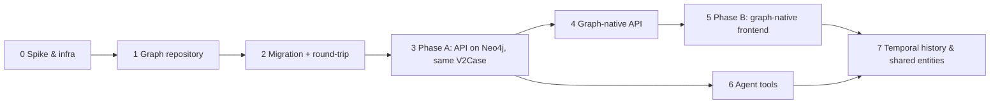

# Neo4j Migration Plan (Backend and Frontend)

A phased plan for moving the Manufacturing Data Pyramid from per-version JSONB snapshots in Postgres to a **Neo4j knowledge graph**, and for evolving the frontend to reflect it.

The "why" is covered in [`WHY_GRAPH_AND_AGENTS.md`](WHY_GRAPH_AND_AGENTS.md), today's model in [`DATA_MODEL.md`](DATA_MODEL.md), and the target user flows in [`KNOWLEDGE_GRAPH_UX.md`](KNOWLEDGE_GRAPH_UX.md). This document covers **how**, step by step, with an exit criterion and a rollback for every phase.

---

## 0. Decisions to make first

These shape everything after them. Each has a recommendation; the ones marked ⚠ need your sign-off.

### D1 ⚠ Versioning: what happens to version history?
| Option | Description |
|---|---|
| **A (recommended)** | Neo4j holds the **live** graph (imported from each project's **latest** version). All existing `v2_project_versions` rows stay in Postgres as a **read-only archive** that can still be opened. New milestones are *published* back into that same table as snapshots. |
| B | Import **every** version into Neo4j as temporal facts (`valid_from` / `valid_to`). Fully queryable history, but a much harder migration and query model on day one. |

Recommendation: **A now, temporal facts later** (Phase 7). Existing history is never touched, and "open version 3" keeps working exactly as today.

### D2 ⚠ What "Save" means
Today, Stage 5 *saves a frozen copy*. On a live, shared graph:
- **Edits autosave** to Neo4j as you work (add node, link, edit workflow).
- **"Publish version"** replaces "Save": it exports the project's subgraph as an immutable snapshot (same `format: 'manufacturing-data-pyramid-v2'` document, `schemaVersion` bumped) into `v2_project_versions`, with a note.
- The local draft in localStorage stops being the main working copy. It becomes only an offline/unsaved-changes buffer, or is removed.

This is the **biggest user-visible change**. Users stop thinking "my file" and start thinking "the shared graph, with published milestones."

### D3 Postgres's role
**Keep Postgres** for users, projects and the snapshot archive. **Neo4j** holds the graph. Benefits: authentication and project metadata stay in a relational store that is good at that job, the archive is the rollback path, and Drizzle stays in use.

### D4 Hosting
- **Local**: add a `pyramid-neo4j` Docker container to `scripts/dev-local.sh` next to `pyramid-db` (ports 7474 browser, 7687 bolt, named volume for data).
- **Replit / production**: Neo4j can't run inside the Replit app, so use a managed instance (Neo4j **Aura**) or a self-hosted VM. Configure through `NEO4J_URI`, `NEO4J_USER`, `NEO4J_PASSWORD`. Check the current Aura tier limits against expected graph size before choosing.
- Driver: `neo4j-driver` in `artifacts/api-server`. It must satisfy the workspace's `minimumReleaseAge: 1440`; don't relax that setting.

### D5 Edition
Neo4j **Community** is enough to start: single database, property uniqueness constraints. Enterprise or Aura adds multiple databases, role-based access and node-key constraints. Revisit when agents need fine-grained permissions inside the database itself (Phase 6).

---

## 1. Target graph schema

### 1.1 Mapping from today's `V2Case`

| Today (`src/v2/types.ts`) | Neo4j |
|---|---|
| Project (Postgres `v2_projects`) | `(:Project {id, name})`, a mirror of the Postgres row for scoping |
| `levels[]` | `(:Project)-[:HAS_LEVEL]->(:Level {id, index, name})` |
| `sectors[]` | `(:Project)-[:HAS_SECTOR]->(:Sector {id, index, name})` |
| `grid` | Properties on `:Project` (`grid_width`, `grid_height`) |
| `overlays.data[]` object | `(:Element:Data {id, project_id, name, …metadata, grid_x, grid_y})` with `-[:AT_LEVEL]->(:Level)` and `-[:IN_SECTOR]->(:Sector)` |
| `overlays.models / agents / decisions` (empty today) | Same `:Element` with labels `:Model`, `:Agent`, `:Decision`, ready for typed nodes later |
| `loops[]` | `(:Workflow {id, project_id, name, description, color, closed})` |
| `connectivity[]` segment | **Two things**: a shared **flow** between elements and a **step** in a workflow (see 1.2) |

**Keep every existing id**: object.id → element id, loop.id → workflow id, connection.id → step id. That follows the repo rule to preserve segment and endpoint IDs, and lets the round-trip check (Phase 2) compare like with like.

### 1.2 Flows and workflow steps

Neo4j relationships can't be the endpoint of other relationships, so a step can't point *at* a `FLOWS_TO` edge. Chosen design:

```cypher
// Shared fact: A feeds B (one per distinct source→target pair in a project)
(a:Element)-[:FLOWS_TO {id, label, description}]->(b:Element)

// Workflow structure: ordered steps, each naming the flow it traverses
(w:Workflow)-[:HAS_STEP]->(s:WorkflowStep {id, sequence, label, description, flow_id})
(s)-[:FROM]->(a)
(s)-[:TO]->(b)
(s)-[:NEXT]->(s2)            // explicit order, so agents can walk a playbook
```

- Agents reasoning about **facts** traverse `FLOWS_TO`. Agents following a **playbook** traverse `HAS_STEP` / `NEXT`.
- Per-loop segment labels move onto the **step**; a flow's own label stays factual.
- Alternative, rejected for now: model each flow as a node (`(:Flow)`). That's more uniform but doubles traversal depth for every agent query.

### 1.3 Constraints and indexes
- Uniqueness on `id` for `:Project`, `:Level`, `:Sector`, `:Element`, `:Workflow`, `:WorkflowStep`. **Verify during migration that ids are globally unique across projects.** If any aren't (e.g. level ids reused), prefix them with the project id and record the mapping.
- Index on `project_id` for every label, because every query is project-scoped.
- Full-text index on `:Element(name, description)` for search and agent `find_entity`. Vector index on embeddings comes later, in Phase 6.

### 1.4 Provenance (from day one, cheap to add)
Every node and relationship gets `created_at`, `created_by` (user id, or `migration`, or later an agent id) and `updated_at`. Phase 6 depends on these.

---

## 2. Phases



### Phase 0: Spike and infrastructure
- Add the Neo4j container to `dev-local.sh`; add `NEO4J_*` env vars; add `neo4j-driver` to `api-server`.
- A health check at `/api/healthz` that also pings Neo4j (report it, don't fail the API).
- A schema-setup script (constraints and indexes from §1.3) that runs like `db push` does today.
- **Exit:** API connects locally and on the chosen hosting; constraints created.
- **Rollback:** remove the container and env vars; nothing else depends on it yet.

### Phase 1: Graph repository (backend only)
In `artifacts/api-server/src/graph/`:
- `caseToGraph(projectId, V2Case)`: writes a whole case with `MERGE` on ids, inside one transaction.
- `graphToCase(projectId) → V2Case`: reads it back in today's shape. Order steps by `sequence`, rebuild `connectivity[]` from steps (one segment per step, using the step id), and leave `models/agents/decisions` empty as today.
- Unit tests with `node:test` (matching the repo's existing test style) against a test Neo4j database.
- **Exit:** for hand-built fixtures, `graphToCase(caseToGraph(x))` is structurally equal to `x`, using the existing `src/v2/jsonStructuralEquality.ts`.

### Phase 2: Migration script
`scripts/migrate-to-neo4j.mjs`:
1. For each project in Postgres, load the **latest** version snapshot (D1-A).
2. Validate it with the same rules as the server's `validateSnapshot` (`v2Save.ts`).
3. **Repair and report** the known integrity gaps (DATA_MODEL.md §3):
   - Sequence gaps: renumber densely and keep order.
   - Loops marked `closed` whose path no longer joins up: set `closed: false` and log it.
   - Stored `sector_id` that disagrees with the grid cell: log only, keep the stored value.
4. Collapse duplicate `(source, target)` pairs **within a project** into one `FLOWS_TO`; every original segment becomes a step pointing at it.
5. Write with `caseToGraph` (idempotent `MERGE`, so it can be safely re-run).
6. **Round-trip check**: `graphToCase` and compare against the repaired snapshot. Print a per-project pass/fail report.

- **Exit:** 100% of projects round-trip; the repair report has been reviewed.
- **Rollback:** delete the Neo4j data; Postgres was never modified.

### Phase 3: Phase A, API on Neo4j with the same contract (no frontend change)
The API's external shape stays `V2Case`; only storage changes.
- `GET /projects/:id/versions/:versionId` still reads the **Postgres archive** (unchanged).
- New `GET /projects/:id/graph` returns `graphToCase` (the live graph as a `V2Case`).
- `POST /projects/:id/versions`: **dual-write**. Write the snapshot to Postgres as today *and* `caseToGraph` to Neo4j.
- Feature flag `GRAPH_BACKEND=on|off` controls whether the app opens projects from the live graph or the latest snapshot.
- Contract-first: add the new endpoints to `lib/api-spec/openapi.yaml` and run Orval codegen. (The frontend currently calls `/api` with plain `fetch`; keep that or switch to the generated hooks as you touch each call.)
- **Exit:** a few weeks of dual-writes with zero round-trip mismatches; the 3D, 2D and save flows behave exactly as before.
- **Rollback:** flag off. Postgres snapshots are still complete and authoritative.

### Phase 4: Graph-native API
Fine-grained, project-scoped endpoints (OpenAPI first):

| Endpoint | Purpose |
|---|---|
| `GET /projects/:id/graph?levels=&types=` | Nodes and relationships (filtered) |
| `POST/PATCH/DELETE /projects/:id/elements/:eid` | Element CRUD |
| `POST/PATCH/DELETE /projects/:id/flows/:fid` | Relationship CRUD; DELETE returns "used by N workflows" unless `?cascade=` is given |
| `POST/PATCH/DELETE /projects/:id/workflows/:wid`, `…/steps` | Workflow and step CRUD; inserting or reordering a step updates `sequence` and `NEXT` |
| `GET /projects/:id/neighbourhood/:eid?hops=` | Neighbourhood view and agent context |
| `GET /projects/:id/paths?from=&to=` | Evidence trails, "how does X reach Y" |
| `POST /projects/:id/publish` | D2: export snapshot → Postgres archive |

- **Concurrency**: a `revision` counter on `:Project`. Writes send the revision they're based on; a mismatch returns 409 and the client refetches. That's enough for small teams; real-time collaboration can come later.
- Validation rules move from "validate a whole snapshot" to "validate each operation" (endpoints exist, same project, relationship type allowed).
- **Exit:** every Walkthrough action can be expressed as one of these calls.

### Phase 5: Phase B, graph-native frontend
See §3 for the detail.
- **Exit:** the Walkthrough runs entirely on graph endpoints; `V2Case` is used only for publish/open-archive.
- **Rollback:** the Phase A frontend still exists behind a flag until this phase is stable.

### Phase 6: Agent tool layer
A separate service (e.g. `artifacts/agent-tools`) exposing **MCP tools** backed by the graph repository:
- **Read-only first**: `describe_schema`, `find_entity`, `neighbourhood`, `paths`, `get_workflow`, `query` (read-only Cypher, with a timeout and row limit).
- **Then write-back as proposals**: `propose_element` / `propose_flow` create nodes and relationships with `status: 'proposed'` and `created_by: <agent>`. Humans approve them in the app.
- Agents as `(:Agent)` nodes with `CAN_READ` / `USES_TOOL` relationships; the tool layer enforces them.
- Add a vector index on element embeddings for semantic `find_entity`.
- Can start in parallel with Phase 4, since it only needs the repository from Phase 1.

### Phase 7: Temporal history and shared entities
- `valid_from` / `valid_to` on nodes and relationships, so "graph as of date X" becomes a filter (D1-B, done incrementally).
- Cross-project shared entities (`:Material {id}` used by many projects), plus the "update everywhere / copy" UX.
- Typed vocabularies and templates (*Quality Investigation*, with the RTM spoiler sample as the demo).

---

## 3. Frontend: how it reflects the graph

### 3.1 Where the change lands
Today the frontend touches the loop/connection model in 7 files:

| File | Uses | Change in Phase B |
|---|---|---|
| `src/v2/types.ts` | `V2Connection`, `V2Loop` | Add `V2Flow`, `V2WorkflowStep`, `V2Workflow`; keep `V2Case` for publish/archive |
| `src/v2/store.ts` | loop builder, CRUD, persistence (55 references) | Split (see 3.2); loop builder reuses flows |
| `src/v2/visibility.ts` | loop → objects/sectors | Workflow → steps → elements; add neighbourhood filters |
| `src/v2/components/V2PreviewPyramid.tsx` | draws segments in 3D | Draws flows; highlights the selected workflow's steps |
| `src/v2/components/V2CrossSection.tsx` | 2D loop view | Same, using workflows |
| `src/v2/components/WalkthroughUI.tsx` | loop table, save stage | Workflow table, relationship table, Publish instead of Save |
| `src/v2/components/SavedProjectBrowser.tsx` | snapshot validation | Opens the live graph; archive versions read-only |

Explorer mode (`src/store.ts`, `src/components/Connections.tsx`) is **unaffected**.

### 3.2 State architecture
Today one Zustand store holds both the case *and* presentation state, persisted to localStorage. With a server-side graph:
- **Server state → TanStack Query** (already installed, currently unused). It handles graph fetching, caching, mutations with optimistic updates, and refetch on 409.
- **Presentation state → Zustand**: selection, 2D/3D view, isolation, panel collapse, camera, density/size sliders. This keeps the existing rule that presentation state is separate and never persisted into the case.
- The persisted shape changes, so **bump the Zustand persist `version` (currently 9) and extend `migrate`**. The migration drops the old `activeCase` from localStorage once the project exists on the server; unsynced local drafts are offered for upload first.

### 3.3 The pyramid becomes a projection
The 3D scene stays the centrepiece but renders **a projection of the graph**:
- Node position = level (from `AT_LEVEL`) + grid cell (`grid_x/grid_y`, via the existing `src/v2/geometry.ts`). Unplaced nodes (e.g. imported records, agents) are auto-laid-out in their level, collapsed under their dataset, or placed in an **agent ring** outside the pyramid.
- Flows are drawn once, even if several workflows use them. Selecting a workflow highlights its steps in order (light→dark gradient, as today).
- **Answer/evidence paths** (from `paths` or an agent answer) use the same highlight mechanism.

### 3.4 Changes to the Walkthrough stages
| Stage | Change |
|---|---|
| Structure | Unchanged at first; later adds vocabulary/templates (Phase 7) |
| Data | Unchanged UI; each add, move or edit is an API mutation (autosave) |
| Visualise | Adds a node-type filter, and "show workflow / show all flows" |
| Connections → **Workflows** | Clicking A then B **reuses the existing flow** if there is one, or creates one. Steps can be reordered or inserted. Deleting a flow warns "used by N workflows" |
| **New: Relationships** | Table of all flows (filter, edit, delete); link two elements without a workflow |
| Save → **Publish** | Autosave indicator always visible; "Publish version" with a note; version list shows published milestones and archive |

After the first pass, the stages become a free-navigation workspace (tabs), keeping the stage list as a checklist.

### 3.5 New views
| View | Notes |
|---|---|
| **Neighbourhood** | Click a node → 1–3 hops, expand on demand. Drives both humans and agent context |
| **Evidence trail** | Pick a node → highlight upstream (or downstream) paths in 3D |
| **2D network** | Force/layered layout with typed, labelled edges, as in the RTM sample. Library options: **Cytoscape.js** (mature, many layouts), **Sigma.js + graphology** (WebGL, large graphs, graphology also gives algorithms), **React Flow** (best for *editing* small graphs), **react-force-graph** (quick 2D/3D force views). Pick after a short spike against a realistic graph size |
| **Tables** | Elements and relationships, filterable |

### 3.6 Agent control room (the unused "Advanced" slot)
Built once Phase 6 exists:
- Agent list with access scope (highlighted subgraph) and tools.
- **Proposals queue**: approve or reject agent-proposed nodes and links, with proposed items drawn dashed in 3D.
- **Ask panel**: question → answer with cited nodes → path highlighted in the pyramid.
- Activity log: which agent read or proposed what, and when (from provenance properties).

---

## 4. Testing and verification
- **Round-trip equality** (Phase 1–3) with `jsonStructuralEquality.ts` is the core safety net.
- `node:test` suites for the graph repository against a disposable Neo4j database (a Docker container started by the test script).
- A migration dry-run mode that prints the repair report without writing.
- Phase A comparison: for a sample of projects, compare the UI rendered from the snapshot vs. from the live graph (same element, flow and workflow counts).
- Performance budget: neighbourhood and path queries under ~200 ms on the largest real project; check `PROFILE` plans for missing indexes.

---

## 5. Risks

| Risk | Mitigation |
|---|---|
| Two stores drift during dual-write | Write Postgres first, then Neo4j; on failure, log and mark for re-sync; the migration script doubles as a re-sync tool |
| Users confused by autosave vs publish | Clear autosave indicator; "Publish" wording; keep the archive visible |
| Hosting cost/limits (Aura) | Size the graph in Phase 0; Community in Docker on a VM as fallback |
| Cypher injection via agent `query` tool | Read-only transactions, parameterised queries, timeouts, row limits, allow-listed procedures |
| Graph library can't handle large graphs | Spike in Phase 5; collapse records; WebGL renderer (Sigma) as fallback |
| Scope creep into typed ontologies too early | Typed vocabularies deferred to Phase 7; Phases 1–5 map today's model 1:1 |

---

## 6. Summary of order
1. Infra and repository (0–1), then **migrate and prove the round trip** (2).
2. Swap storage behind the **unchanged** API and UI (3), with Postgres as the rollback.
3. Graph-native API (4), then the graph-native frontend (5): flows shared across workflows, relationships table, neighbourhood/evidence/network views, Publish instead of Save.
4. Agent tools (6, can start after 3), then temporal history and shared entities (7).
